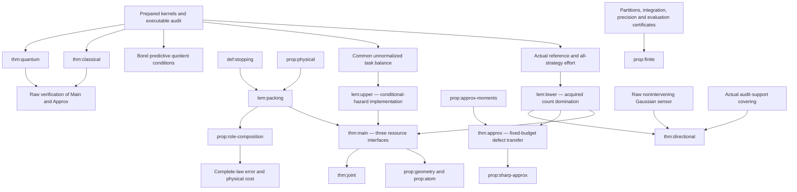

# Theorem dependency graph

Identifiers below are stable LaTeX labels; final numbered statements are in BUILD_RECEIPT.json.

No realization is a premise in the proof of thm:main. The arrows from classical/quantum are verification arrows. The directional result does not assume exact balance and is proved independently using the acquired-count converse plus a uniform radial upper.
